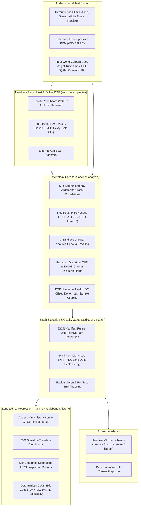

# AudioBench — Professional Audio Render Regression Benchmark & DSP Test Suite

[](https://github.com/gio961gio/audiobench/actions/workflows/ci.yml)
[](https://www.python.org/)
[](LICENSE)
[](#supported-standards--quality-gates)
[](https://audiobench-engine.streamlit.app)

**AudioBench** is an automated, broadcast-grade audio regression test bench and DSP metrological verification suite. Engineered for audio software developers, DSP engineers, plugin manufacturers (VST3/AU), and mastering workflows, it computes sample-accurate signal metrics, performs latency-compensated harmonic and spectral analysis, enforces multi-tier quality gates, and tracks longitudinal performance across git commits.

Developed by **Giovanni Antonecchia** (*Music Engineering, Politecnico di Milano*).

> [!NOTE]
> **Proprietary DSP Engine & Academic Evaluation**  
> AudioBench's core DSP algorithms (ITU-R BS.1770-4 4x polyphase FIR filter, 7-band Welch PSD spectral energy tracking, THD/THD+N analysis, and automated headless VST3/AU host harness) are protected intellectual property.  
> 
> You can **test the engine live with your own audio files** via the **[Interactive Web Demo](https://audiobench-engine.streamlit.app)** or request full source code access for institutional and academic evaluation by contacting [Giovanni Antonecchia](mailto:gio.antonecchia961@gmail.com).

---

## 📸 Visual Showcase & Interface

### 1. Minimalist Dark Studio Web Dashboard
Interactive local and cloud web workstation featuring 3-channel synchronized auditioning, latency-compensated null listening, and instant metric scorecards.


---

### 2. A/B Differential Listening Player
Audition the Reference, Actual Render, and the amplified Difference Residual Signal ($e[n] = y[n] - x[n]$) with bit-exact in-memory WAV serialization, up to $+48\text{ dB}$ difference gain boost, and a $-0.5\text{ dBFS}$ audio safety limiter.

- **Latency-Compensated Null Auditioning:** Toggle between raw null and delay-compensated null ($y[n - \Delta n] - x[n]$) to isolate non-linear harmonic distortion and aliasing from linear phase delay.
- **Bit-Exact WAV Serialization:** Direct uncompressed 16-bit PCM streaming bypassing Streamlit's default browser auto-normalization to 0 dBFS.
- **Live A/B Sandbox:** Instant drag-and-drop comparison of arbitrary WAV audio pairs on the fly.

---

## 🏛️ System Architecture

AudioBench is built on a decoupled, **local-first** architecture: the core DSP metrology engine is completely independent of the presentation layers, enabling concurrent execution, headless CI/CD automation, and zero cloud dependency.



---

## 🎯 Supported Standards & Quality Gates

AudioBench enforces strict, configurable quality gates across all critical signal dimensions:

| Dimension | Metric | Standard / Algorithm | Typical Tolerance |
| :--- | :--- | :--- | :---: |
| **Signal Fidelity** | SNR (Signal-to-Noise Ratio) | Logarithmic energy ratio ($10 \log_{10} \frac{P_{ref}}{P_{err}}$) | $\ge 60.0\text{ dB}$ |
| **Spectral Balance** | 7-Band Energy Delta | Welch PSD (Sub, Bass, Low-Mid, Mid, High-Mid, Presence, Brilliance) | $\le 1.0\text{ dB}$ |
| **Inter-Sample Peak** | True-Peak Level | ITU-R BS.1770-4 Annex 2 (4x Polyphase FIR) | $\le -1.0\text{ dBTP}$ |
| **Harmonic Linearity**| THD / THD+N | 4-term Blackman-Harris window + Parabolic peak interpolation | $\le -40.0\text{ dB}$ |
| **Timing & Delay** | Latency Offset | Cross-correlation maximum delay ($\Delta t$) | $\le 0.5\text{ ms}$ |
| **Numerical Health** | DC Offset / Clipping / Subnormals | Floating-point IEEE-754 denormal and plateau detector | $\le 0.001\text{ DC}$ / $0\text{ clips}$ |

---

## 🔬 Ground Truth Benchmark Results

AudioBench undergoes continuous verification against real-world hardware and normative audio corpora:

### 1. Alec Wright Hardware Amplifier Benchmark (`examples/real_datasets/guitar_hardware/`)
- Authentic clean DI electric guitar recordings processed through physical hardware:
  - **Blackstar HT-1 Tube Guitar Amplifier**
  - **Electro-Harmonix Big Muff Pi Distortion Pedal**
- **Metrological Insights:** Evaluates non-linear vacuum tube compression, high harmonic distortion ($\text{THD} > -15\text{ dB}$), and asymmetric waveform clipping.

### 2. EBU Tech 3253 Sound Quality Assessment Material (SQAM) (`examples/real_datasets/ebu_sqam/`)
- 10 reference tracks from the European Broadcasting Union normative test suite:
  - Multilingual speech (English, French, German, Italian)
  - Extreme transient signals (Castanets, Harpsichord, Glockenspiel)
  - Broad dynamic solo instruments (Violoncello, Soprano Vocal)
- **Metrological Insights:** Validates 7-band Welch spectral tracking and True-Peak overshoot detection across complex acoustic spectra.

### 3. Zamaudio Acoustic & Plate Impulse Responses (`examples/real_datasets/acoustic_impulses/`)
- Authentic 48 kHz / 24-bit physical impulse responses (Damien Zammit / Zamaudio):
  - Studio booths, recording live rooms, EMT vintage plates, stone cathedrals.
- **Metrological Insights:** Validates spatial convolution fidelity, early reflection latency alignment, and spectral decay curves.

See [`examples/real_datasets/CREDITS.md`](examples/real_datasets/CREDITS.md) for full licensing and academic source attribution.

---

## 🚀 Live Evaluation & Interactive Demo

The AudioBench engine is hosted and ready for immediate online evaluation:

[](https://audiobench-engine.streamlit.app)

### How to Evaluate:
1. Open the **[Live Interactive Web Demo](https://audiobench-engine.streamlit.app)** in any desktop or mobile browser.
2. In the **Live A/B Sandbox** or **Suite & A/B Differential Player**, audition reference and actual audio renders.
3. Toggle **Compensate Latency** to isolate non-linear harmonic distortion from linear phase delay.
4. Use the **Difference Gain Boost** slider (up to $+48\text{ dB}$) to audition sub-audible artifacts with the built-in $-0.5\text{ dBFS}$ safety ceiling.
5. Inspect real-time metrological indicators (ITU-R BS.1770 True-Peak, 7-Band Welch PSD, THD/THD+N, SNR) and download standalone HTML inspection reports.

---

## ⚙️ Headless CLI & Automated Pipeline Architecture

In addition to the interactive dashboard, AudioBench includes a high-throughput headless CLI designed for automated DSP build pipelines, plugin regression suites, and CI/CD audio test benches.

### Deterministic Exit Codes for CI/CD

| Exit Code | Classification | Operational Meaning |
| :---: | :---: | :--- |
| `0` | **PASS** | All evaluated renders strictly satisfy every normative threshold. |
| `1` | **FAIL** | One or more audio renders violated critical quality gates (true peak overshoot, SNR, THD, spectral delta). |
| `2` | **ERROR** | Unreadable/corrupted audio header, missing stem, or invalid manifest payload. |

### Output Artifacts
- **Structured JSON**: Machine-readable payload printed to `stdout` or disk for automated CI build pipelines.
- **Standalone HTML**: Executive visual report with waveform overviews, 7-band frequency response tables, and embedded JSON results.
- **Append-Only History**: Longitudinal regression tracking (`history.jsonl`) with Git commit SHA and SVG trendline sparklines.

---

## 🧪 Automated Test Suite

AudioBench features a comprehensive test suite of 97 automated unit, integration, and benchmark tests:

```text
tests/test_analysis.py::test_true_peak_bs1770_inter_sample_overshoot PASSED
tests/test_analysis.py::test_welch_psd_seven_bands PASSED
tests/test_analysis.py::test_thd_pure_sine PASSED
tests/test_analysis.py::test_numerical_health_dc_clipping_subnormal PASSED
tests/test_audio.py::test_wav_read_write_metadata PASSED
tests/test_batch.py::test_batch_manifest_execution_pass_fail PASSED
tests/test_cli.py::test_cli_batch_exit_codes PASSED
tests/test_history.py::test_history_append_and_diff_regression PASSED
tests/test_metrics.py::test_metrics_delay_estimation PASSED
tests/test_plugins.py::test_pure_python_dsp_effects PASSED
tests/test_plugins.py::test_pedalboard_vst3_host PASSED
tests/test_ui.py::test_in_memory_wav_serialization PASSED
============================= 97 passed in 16.65s =============================
```

---

## 🔒 Source Code Access & Institutional Evaluation

The core DSP engine and CLI distribution are proprietary intellectual property of **Giovanni Antonecchia** (*Music Engineering, Politecnico di Milano*).

For institutional review, academic evaluation, or commercial deployment inquiries, please contact:  
📧 **[gio.antonecchia961@gmail.com](mailto:gio.antonecchia961@gmail.com)**

---

## 📄 License & Intellectual Property

Copyright © 2026 Giovanni Antonecchia. All rights reserved.  
The underlying AudioBench DSP engine, algorithms, offline render pipeline, and batch regression test suite are proprietary intellectual property. See the [LICENSE](LICENSE) file for evaluation terms.
