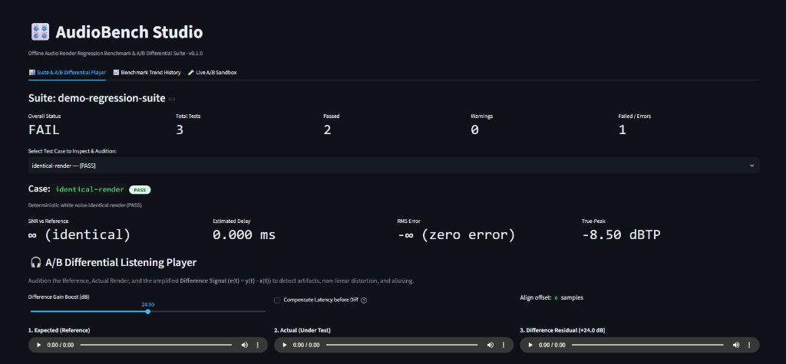

# AudioBench

**A lightweight offline regression test bench for audio renders and DSP algorithms.**



AudioBench compares an expected/reference render with an actual render, computes signal-level metrics, applies configurable quality gates, and produces a self-contained HTML report plus machine-readable JSON. It is designed as a small portfolio project that can be extended into automated DSP/plugin QA.

> **Current scope:** AudioBench provides deterministic stimulus generation, offline audio comparison, quality gating, batch manifest execution, and headless audio plugin hosting / DSP offline rendering (VST3/AU via Pedalboard, pure-Python built-in DSP effects, and external CLI tools). It does not control interactive DAWs or silently resample audio.

## Features

- **Web Studio Dashboard & A/B Differential Listening Player** (`audiobench ui` or `Launch_App.bat`): interactive Streamlit dark-theme workstation with 3-channel synchronized auditioning (Reference, Actual, Difference Residual), up to $+48\text{ dB}$ Gain Boost, and a $-0.5\text{ dBFS}$ audio safety ceiling.
- **Bit-exact in-memory WAV serialization**: streams uncompressed 16-bit PCM WAV bytes directly to the browser player, bypassing Streamlit's default auto-normalization to 0 dBFS to preserve authentic listening levels.
- **Latency-compensated null auditioning**: toggle between Raw Null ($y[n] - x[n]$) and Delay-Compensated Null ($y[n - \Delta n] - x[n]$) to isolate pure harmonic distortion and aliasing from phase comb-filtering.
- **Live A/B Sandbox**: drag-and-drop comparison of arbitrary WAV pairs on the fly with immediate sample-accurate metric evaluation.
- Deterministic test stimuli: impulse, 1 kHz sine, logarithmic sweep, seeded white noise, and silence.
- **Headless plugin hosting & offline DSP rendering** (`audiobench render`): render audio through VST3/AU plugins (via Spotify's Pedalboard), pure-Python DSP effects (gain, lowpass, highpass, delay, soft-clip), or arbitrary external CLI processors.
- **Dynamic stimulus rendering in batch manifests**: specify `input` + `plugin` to render test cases on the fly before regression comparison, with parameter inheritance and override.
- Reference-vs-actual comparison without silently resampling files.
- Duration, peak and RMS levels, RMS error, SNR, relative error, sample correlation, maximum sample error, mean spectral-magnitude delta, and gain-normalized spectral-shape error.
- **7-band acoustic frequency response analysis** (Welch PSD) with active-band clamping to avoid spurious quantization noise in silent regions.
- **THD and THD+N harmonic distortion analysis** using 4-term Blackman-Harris windowing and parabolic peak interpolation on sinusoidal renders.
- **True-Peak estimation** compliant with ITU-R BS.1770-4 (4x/2x oversampling) detecting inter-sample peaks.
- **DSP numerical health diagnostics**: automated detection of DC offset, single-precision subnormal/denormal floats, and sample clipping.
- Independent quality gates for fidelity, latency, duration, frequency bands (`max_band_delta_db`), distortion (`max_thd_db`), and True-Peak (`max_true_peak_dbfs`).
- Batch test suite execution from a JSON manifest with fault isolation, relative path resolution, and per-test threshold overrides.
- **Benchmark history & longitudinal regression tracking** (`audiobench history`): record suite runs in append-only `history.jsonl`, detect metric regressions against past Git commits or baselines (`audiobench history diff`), and render standalone HTML dashboards with responsive SVG sparklines (`audiobench history report`).
- **Batch atomic CI baseline check**: pass `--baseline <commit_or_file>` and `--record-history` directly to `audiobench batch` for single-step regression gating in CI.
- Standalone HTML reports (per-test, suite summary dashboard, and history trendlines) with waveform overview, frequency band table, and embedded JSON results.
- CLI exit codes suitable for local scripts and CI: `0` for PASS/WARN, `1` for FAIL/ERROR, `2` for invalid input/runtime/manifest error. Use `--fail-on-warn` to make warnings fail a CI job.
- Comprehensive unit tests covering DSP algorithms, comparison metrics, delay sign, batch manifests, error isolation, plugin adapters, history tracking, and CLI exit codes.

## Quick start

Python 3.10 or newer is recommended.

```bash
# 1. Create and activate a virtual environment
python -m venv .venv
# macOS/Linux
source .venv/bin/activate
# Windows PowerShell: .venv\Scripts\Activate.ps1

# 2. Install the project and test dependencies
python -m pip install -e ".[dev]"

# 3. Generate deterministic WAV stimuli
audiobench generate --output-dir examples/test_signals --sample-rate 48000 --duration 1

# 4. Compare two renders (replace these paths with your own files)
audiobench compare \
  --expected examples/reference.wav \
  --actual examples/render.wav \
  --report reports/comparison.html \
  --json reports/comparison.json

# 5. Render offline audio through a plugin or DSP effect
audiobench render \
  --plugin gain \
  --input examples/test_signals/sine_1k.wav \
  --output examples/sine_gain.wav \
  --params '{"gain_db": -6.0}'

# 6. Run a full regression suite from a JSON manifest
audiobench batch \
  --manifest examples/demo/demo_manifest.json \
  --output-dir reports/batch

# 7. Launch the interactive Web Studio & A/B Differential Player
audiobench ui
# (Or on Windows: double-click Launch_App.bat)

# 8. Run the tests
pytest
```

## CLI Command Reference

| Command | Purpose | Example |
|---|---|---|
| `audiobench generate` | Synthesize deterministic test stimuli (impulses, sines, sweeps, noise) | `audiobench generate -d 1 -o stimuli` |
| `audiobench compare` | Sample-accurate comparison between reference and actual renders | `audiobench compare -e ref.wav -a test.wav` |
| `audiobench render` | Offline rendering via VST3/AU, pure Python DSP, or CLI tools | `audiobench render --plugin gain -i in.wav -o out.wav` |
| `audiobench batch` | Execute automated regression suites from JSON manifests | `audiobench batch -m suite.json -o reports` |
| `audiobench history` | Record benchmarks, compare baselines, and plot trendlines | `audiobench history diff --baseline HEAD~1` |
| `audiobench ui` | Launch the Web Studio Dashboard & A/B Differential Player | `audiobench ui --port 8501` |

The CLI is also available without installing the console script:

```bash
python -m audiobench --help
python -m audiobench generate --help
python -m audiobench render --help
python -m audiobench compare --help
python -m audiobench batch --help
python -m audiobench history --help
python -m audiobench ui --help
```

## Batch regression testing (JSON manifest)

Run an entire suite of regression comparisons with a single command:

```bash
audiobench batch \
  --manifest path/to/manifest.json \
  --output-dir reports/batch
```

### Manifest schema

A manifest can compare pre-rendered WAV pairs (`expected` + `actual`) or render test stimuli dynamically (`expected` + `input` + `plugin`):

```json
{
  "name": "dsp-regression-suite",
  "thresholds": {
    "min_snr_db": 60.0,
    "max_delay_ms": 0.5,
    "max_duration_delta_ms": 1.0,
    "max_error_dbfs": -80.0
  },
  "plugin": {
    "type": "builtin",
    "effect": "gain",
    "parameters": {
      "gain_db": -6.0
    }
  },
  "tests": [
    {
      "id": "filter-bypass",
      "description": "Bypass processing must preserve reference audio (pre-rendered)",
      "expected": "renders/ref_bypass.wav",
      "actual": "renders/test_bypass.wav"
    },
    {
      "id": "dynamic-gain-test",
      "description": "Render stimulus on the fly through plugin and compare against expected",
      "expected": "renders/expected_gain_minus_12.wav",
      "input": "stimuli/sine_1k.wav",
      "plugin": {
        "parameters": {
          "gain_db": -12.0
        }
      }
    }
  ]
}
```

* **Relative paths:** `expected`, `actual`, and `input` paths are resolved relative to the directory containing the manifest file.
* **Dynamic rendering:** If `input` is specified, the file is rendered using the configured `plugin` adapter (supporting VST3/AU via Pedalboard, built-in pure Python DSP chains, or external CLI commands). Renders are saved in `<output-dir>/renders/<test_id>_actual.wav` (or processed in-memory when no output directory is set).
* **Threshold and plugin overrides:** Individual test cases inherit suite-level thresholds and plugin configurations, selectively overriding parameters.
* **Fault isolation:** An unreadable, corrupted, or failing render in one test case is recorded as `ERROR` without aborting the rest of the suite.
* **Dashboard output:** Generates `<output-dir>/summary.html` and `<output-dir>/summary.json`, alongside individual HTML and JSON reports for each test case.

## Example workflow

1. Choose one algorithm or processing chain you can render offline.
2. Generate or prepare a known input stimulus (for example `white_noise.wav` or `sweep.wav`).
3. Render the stimulus through a known-good/reference version and save that output as `reference.wav`.
4. Render the same stimulus through the code/version you are testing and save it as `render.wav`.
5. Run `audiobench compare ...` and inspect both the console result and the HTML report.
6. Keep the JSON report as a CI artifact or compare it across commits.

For an exact regression test, the expected and actual render should be produced with the same sample rate, channel layout, input, plugin settings, and render range. If the algorithm is intentionally changed, update the reference only after reviewing the differences.

## Metrics and interpretation

| Metric | What it tells you | Important caveat |
|---|---|---|
| Duration delta | Whether frame counts agree | A duration mismatch can also reflect a different render range. |
| Sample peak / RMS | Absolute output level | Sample peak is not the same as oversampled true peak. |
| RMS error / SNR | How far samples differ from the reference | A one-sample delay can produce a large error even when the sound is otherwise similar. |
| Relative error | Error RMS relative to reference RMS | Undefined for a silent reference. |
| Correlation | Similarity of sample shapes | Not a perceptual quality score. |
| Spectral magnitude delta | Mean absolute difference between magnitude spectra in dB | A diagnostic summary, not a calibrated frequency-response measurement. |
| Spectral-shape error | Difference after normalizing spectra for overall RMS level | Helps distinguish broad level changes from shape changes, but depends on the test signal. |
| Estimated delay | Approximate offset found by cross-correlation | Periodic inputs (especially pure sine waves) can make latency ambiguous. Prefer impulse or broadband/noise stimuli. |
| SNR after estimated alignment | Difference after compensating for the estimated delay | Diagnostic only; quality gates still use the unaligned render so a latency regression is not hidden. |

No single number describes audio quality. Use metrics as regression indicators and pair them with listening and domain-specific checks.

## Quality gates

Default gates are deliberately configurable:

- **Fidelity:** SNR must be at least `60 dB`, unless the signals are sample-identical. For a silent/near-silent reference where SNR is undefined, the absolute RMS error must be at or below `-80 dBFS`.
- **Latency:** absolute estimated delay must be at or below `0.5 ms`.
- **Duration:** absolute duration difference must be at or below `1 ms`.

Example with stricter tolerances:

```bash
audiobench compare \
  --expected reference.wav \
  --actual render.wav \
  --min-snr-db 80 \
  --max-delay-ms 0.1 \
  --max-duration-delta-ms 0 \
  --fail-on-warn
```

Thresholds depend on the system under test. A nonlinear effect, analog-modeling plugin, random modulation, or intentionally changed DSP behavior may need a different protocol. Document the test setup and never loosen a threshold merely to make a test pass.

## Benchmark history and regression tracking

AudioBench tracks metrics across Git commits and builds, enabling longitudinal regression detection in CI:

```bash
# 1. Record a batch summary to the benchmark history (.benchmarks/history.jsonl)
audiobench history record --summary reports/batch/summary.json

# 2. Compare current run against a baseline (commit hash, 'latest', or JSON summary)
audiobench history diff --baseline latest --current reports/batch/summary.json

# 3. Generate a standalone HTML trend dashboard with native SVG sparklines
audiobench history report --output reports/history.html

# 4. Or execute batch with single-step baseline checking and auto-recording in CI:
audiobench batch \
  --manifest path/to/manifest.json \
  --baseline latest \
  --record-history
```

### Regression thresholds

By default, `history diff` flags a regression (exit code 1) when:
- Any test case changes state from `PASS` to `FAIL` or `ERROR`.
- **SNR drops** by more than `1.0 dB`.
- **Delay increases** by more than `0.05 ms` (~2 samples at 48 kHz).
- **True-Peak increases** by more than `0.1 dBTP`.
- **THD increases** by more than `1.0 dB`.

## Web Studio Dashboard & A/B Differential Listening Player

Launch the local interactive workstation in a single command or double-click `Launch_App.bat`:

```bash
# Launch interactive Streamlit Web Studio
audiobench ui

# Or launch on a custom host/port headless
audiobench ui --port 8505 --host 127.0.0.1 --no-browser
```

### Key Capabilities

1. **Bit-Exact In-Memory Audio Playback:**
   Standard Streamlit audio playback silently normalizes raw arrays to 0 dBFS, destroying true relative listening levels. AudioBench encodes audio into 16-bit PCM WAV in memory (`io.BytesIO`), guaranteeing bit-accurate level reproduction across Expected, Actual, and Difference streams.
2. **Amplified Difference Residual ($e(t) = y(t) - x(t)$):**
   Boost subtle cancellation residuals up to $+48\text{ dB}$ (default $+24\text{ dB}$) to audition non-linear harmonic distortion, aliasing, and filter tail truncation that are otherwise inaudible at nominal levels.
3. **Hardware & Ear Safety Limiter:**
   Auditioning anti-phase or heavily distorted signals with $+24\text{ dB}$ boost can produce catastrophic digital clipping ($+30\text{ dBFS}$). AudioBench continuously monitors the residual peak and dynamically attenuates the gain to guarantee a strict $-0.5\text{ dBFS}$ ($0.94406$) ceiling, displaying a real-time amber badge (`⚠️ Safety Limiter Active`) when triggered.
4. **Raw Null vs Delay-Compensated Null:**
   - **Raw Null ($y[n] - x[n]$):** Plays back the exact time-domain subtraction, revealing phase discrepancies and latency comb-filtering.
   - **Delay-Compensated Null ($y[n - \Delta n] - x[n]$):** Shifts the actual signal by the estimated latency before subtraction, canceling out the linear phase shift to expose pure non-linear harmonic distortion, aliasing, and quantization noise.
5. **3 Workstation Tabs:**
   - **Suite & A/B Differential Player:** Inspect automated batch summaries with KPI cards, DSP metrics (SNR, RMS error, True-Peak), and synchronized 3-player listening.
   - **Benchmark Trend History:** Interactive trendlines plotting metric progressions (SNR, True-Peak) across Git commits and builds.
   - **Live A/B Sandbox:** Instant drag-and-drop WAV comparison with sample rate checking and live difference nulling.

## Architecture

```text
WAV / Manifest / Input Stimulus
             │
             ├──> plugins.py (VST3 / AU / Builtin / CLI Rendering)
             │        │
             ▼        ▼
       audio.py / batch.py ──> metrics.py / analysis.py ──> quality gates
             │                         │                           │
             ▼                         └───────────┬───────────────┘
       history.py (JSONL & SVG Sparklines)         v
             │                          report.py (HTML + JSON)
             ▼                                     │
      app.py (Web Studio & A/B Player)          cli.py
```

- `audio.py`: safe WAV loading/writing and deterministic stimuli.
- `plugins.py`: headless plugin hosts (VST3/AU via Pedalboard, built-in pure Python DSP chains, external CLI tools).
- `batch.py`: manifest parsing, fault-isolated suite runner, dynamic rendering orchestration, and path resolution.
- `history.py`: append-only benchmark history tracking (`history.jsonl`), metric regression detection, and SVG trendline dashboard generation.
- `metrics.py`: sample-based comparison metrics, cross-correlation delay estimation, and quality gate evaluations.
- `analysis.py`: 7-band acoustic Welch PSD, harmonic distortion analysis (THD/THD+N), True-Peak oversampling, and DSP numerical sanity checks.
- `report.py`: standalone per-test and summary dashboard HTML reports; no CDN or browser-side dependencies.
- `app.py`: interactive Streamlit Web Studio Dashboard & A/B Differential Listening Player with Anti-Slop Studio Dark Theme.
- `cli.py`: command-line entry point with CI-friendly exit codes (`0`, `1`, `2`).

## Testing

```bash
pytest
```

The unit test suite contains **97 tests** covering DSP algorithms, comparison metrics, delay sign, batch manifests, error isolation, plugin adapters, history tracking, in-memory audio serialization, difference math, safety limiter clamping, and CLI exit codes.

## Ground Truth Benchmark Datasets

AudioBench includes 3 curated benchmark suites with real, authentic audio recordings (~23.8 MB) in `examples/real_datasets/`:

1. **`guitar_hardware/`**: Real clean DI electric guitar signals paired with hardware recordings from a **Blackstar HT-1 Tube Guitar Amplifier** and an **Electro-Harmonix Big Muff Pi** distortion pedal (courtesy of Alec Wright's open research).
2. **`ebu_sqam/`**: 10 official reference tracks from **EBU Tech 3253 (SQAM)**, including speech in 4 languages, castanets (ultra-fast transient response), glockenspiel, violoncello, harpsichord, and opera vocal.
3. **`acoustic_impulses/`**: Authentic 48 kHz / 24-bit acoustic impulse responses (courtesy of Damien Zammit / Zamaudio) measured in recording studio booths, live rooms, EMT vintage plate reverbs, and stone halls/cathedrals.

Execute any of the benchmark suites with a single command:

```bash
python -m audiobench batch -m examples/real_datasets/guitar_hardware/manifest.json
python -m audiobench batch -m examples/real_datasets/ebu_sqam/manifest.json
python -m audiobench batch -m examples/real_datasets/acoustic_impulses/manifest.json
```

See [`examples/real_datasets/CREDITS.md`](examples/real_datasets/CREDITS.md) for full licensing and academic source attribution.

## Roadmap

Upcoming milestones:

1. [x] **Batch/manifest mode:** suite execution from JSON manifests with per-test thresholds and aggregated HTML/JSON reporting.
2. [x] **Band-wise frequency-response checks:** Welch PSD analysis across 7 acoustic bands with noise-floor clamping.
3. [x] **THD+N & True-Peak test protocol:** calibrated sine-based harmonic distortion analyzer and ITU-R BS.1770-4 inter-sample peak measurement.
4. [x] **Plugin adapter & automated rendering:** headless VST3/AU host via Pedalboard, built-in pure Python DSP chains, CLI adapter, and `render` command.
5. [x] **Benchmark history & regression tracking:** track render metrics over time in append-only JSONL, detect regressions against Git baselines, and render SVG trendline dashboards.
6. [x] **Web Studio Dashboard & A/B Differential Player:** interactive dark-theme workstation with bit-exact in-memory WAV serialization, $+24\text{ dB}$ difference gain boost, $-0.5\text{ dBFS}$ safety limiter, and latency compensation.
7. [ ] **CI integration:** publish HTML/JSON reports and regression summaries as GitHub Actions artifacts on every commit.

Do not market items on the roadmap as implemented features.

## Limitations

- Plugin execution operates headlessly for offline rendering; AudioBench does not control interactive GUI DAWs or graphical automation.
- Sample rates and channel counts must match. The tool refuses silent resampling because it can mask test setup errors.
- WAV files are decoded to floating point for analysis; the original integer bit depth is not treated as a quality metric.
- Delay is an estimate from cross-correlation. Silence and periodic signals may not support an unambiguous estimate.
- RMS/peak/SNR/correlation are diagnostics, not subjective listening tests or compliance certification.

## Continue development in Antigravity

Open this repository folder in Antigravity and start by reading [`AGENTS.md`](AGENTS.md) and [`ANTIGRAVITY_HANDOFF.md`](ANTIGRAVITY_HANDOFF.md). The handoff explains the project goal, current implementation, verified tests, known limitations, architecture, and the suggested next milestone (batch comparisons from a JSON manifest).

Recreate the included end-to-end PASS/FAIL examples with:

```bash
python scripts/create_demo.py
```

The reproducible audio fixtures and reports are in [`examples/demo/`](examples/demo/). They compare an exact render with a synthetic render delayed by 2.5 ms.

## License

MIT. See [LICENSE](LICENSE).
